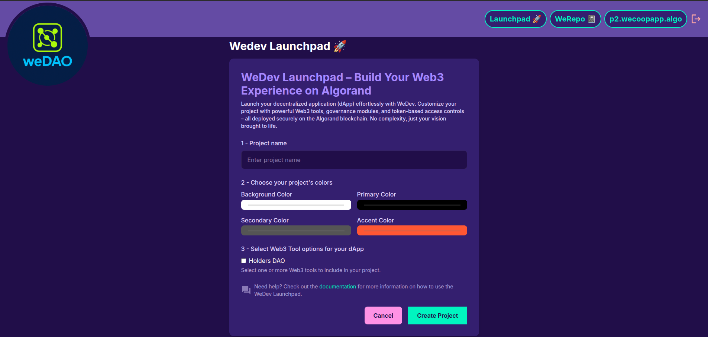
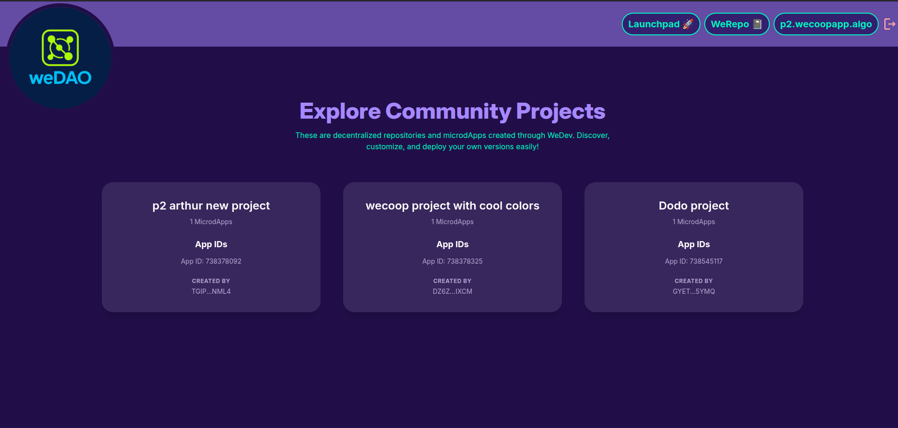

# weDev

**Configurable DAO interfaces and project registries on Algorand.**

weDev explores a modular way to assemble small Web3 applications: a wallet-connected interface, reusable governance contracts, a registry for project configuration, and token launch experiments. Projects can carry their own names, links, and color palettes through the interface.

Built during the Castell D'Code Retreat with support from the Algorand Foundation, led by Arthur Rabelo and Kieran Nelson.



## Explore the modules

| Module | Source | Focus |
| --- | --- | --- |
| Frontend | [`front-end/`](front-end/) | Remix routes, wallet integration, project themes, and DAO screens |
| weDAO | [`we_dao/`](we_dao/) | Yes/no governance and reward-governance contracts |
| weRepo | [`we_repo/`](we_repo/) | On-chain project registry and configuration |
| weLaunch | [`we_launch/`](we_launch/) | Token and token-factory contract experiments |

The frontend includes proposal forms, voting interfaces, wallet-address project views, and themed dApp routes. Pera, Defly, and Lute are configured in the wallet provider.

## Run the frontend

Use **Node.js 22+** and **npm 10.9+**. The npm application is inside `front-end`, rather than at the repository root.

```sh
git clone https://github.com/p2arthur/weDev.git
cd weDev/front-end
npm ci
cp .env.example .env
npm run dev
```

Open the URL printed by Remix/Vite. Review `.env`, [`app/services/providers.tsx`](front-end/app/services/providers.tsx), and the contract-call modules before using a wallet. The checked-in wallet provider selects MainNet while the example environment references a TestNet API; align the wallet, clients, assets, and application IDs for your chosen network.

The registry integration also reads `VITE_REPO_CONTRACT_APP_ID`, which is not included in the base example. Browser-exposed `VITE_` variables must not hold private service credentials.

## Contract workspaces

Each contract module has its own AlgoKit configuration, scripts, and dependencies. Begin with the [weDAO workspace](we_dao/README.md), [registry workspace](we_repo/README.md), or [launch workspace](we_launch/README.md). Contract development and frontend development are separate setup paths.

## Development commands

Run these from `front-end`:

| Command | Purpose |
| --- | --- |
| `npm run dev` | Start the Remix development server |
| `npm run typecheck` | Check TypeScript |
| `npm run lint` | Run ESLint |
| `npm run build` | Build the Remix application |
| `npm start` | Serve a completed build |

## Project status

This is a retreat prototype with implemented governance and registry components. The launchpad's project-creation handler is unfinished, so the interface should not be described as a complete one-click deployment product. Staking pools, analytics, and a public microdApp SDK remain ideas rather than shipped features.


